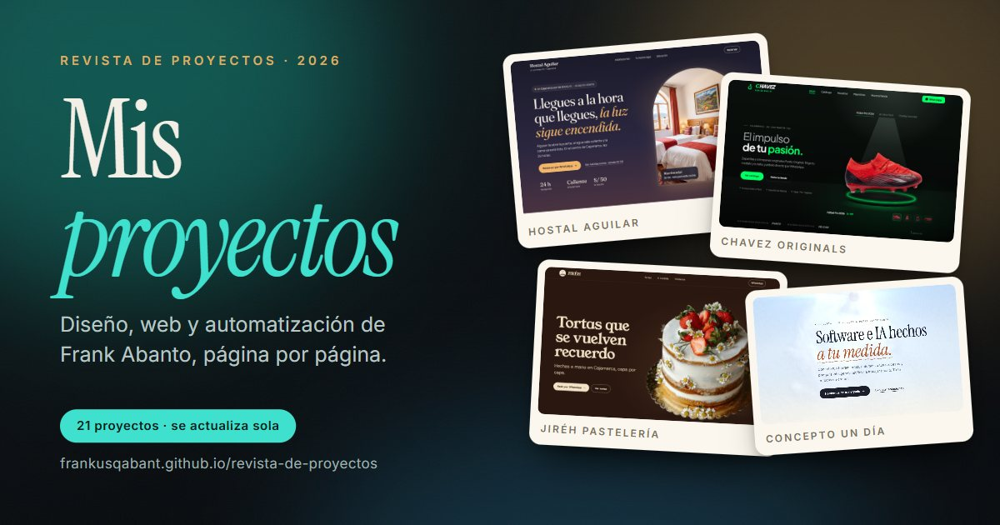

<div align="center">

<a href="https://frankusqabant.github.io/revista-de-proyectos/">
  
</a>

# Revista de proyectos

**Mis proyectos públicos de GitHub, en una revista digital: pasa las páginas, mira la captura de cada uno y entra a la demo o al código.**

[](https://frankusqabant.github.io/revista-de-proyectos/)


[](LICENSE)

### [Abrir la revista →](https://frankusqabant.github.io/revista-de-proyectos/)

</div>

---

## ✨ Qué incluye

| | |
|---|---|
| 📖 **Formato revista** | Por cada proyecto, una página con su captura y otra con su ficha y los enlaces a la demo y al código. En el móvil, una página por pantalla. |
| 🍃 **Páginas de papel** | Las hojas se curvan al pasar, con su sombra; se puede arrastrar la esquina. Motor: [StPageFlip](https://github.com/Nodlik/StPageFlip) (MIT), guardado en el propio repositorio. |
| 🎨 **Portada propia** | Verde petróleo, ámbar y terracota con curvas de nivel, como los cerros de Cajamarca. |
| 🌓 **Contraste siempre** | Con fondo oscuro la revista es de papel claro, y con fondo claro la revista es oscura. Sigue el tema del sistema y el botón lo cambia, sin guardar nada en tu navegador. |
| 🔄 **Se actualiza sola** | Cada 30 minutos una acción de GitHub lee mis repositorios públicos: los nuevos entran, los cambiados se actualizan y los eliminados salen. |
| 🪶 **Ligera** | Unos 17 KB de código comprimido en total (script, estilos y motor de páginas). |

## 🕹️ Controles

| Acción | Control |
| :--- | :--- |
| Pasar página | Clic o toque en la página, arrastrar la esquina, deslizar, o `←` `→` |
| Volver a la portada | `Inicio` |
| Cambiar de tema | Botón de arriba a la derecha |

## 🧱 Estructura

```
docs/                    el sitio (GitHub Pages sirve esta carpeta)
├─ index.html  style.css  script.js
├─ vendor/               StPageFlip 2.0.7 y su licencia
├─ data/proyectos.json   proyectos y capturas (lo escribe la sincronización)
├─ capturas/             capturas hechas a mano (<repo>.webp)
├─ fonts/                fuentes propias
├─ og.jpg                imagen para compartir
├─ icon.svg  apple-touch-icon.png  manifest.webmanifest   iconos e instalación
└─ robots.txt  sitemap.xml   para los buscadores
scripts/sync-repos.mjs   sincronización con la API de GitHub
.github/workflows/       ejecución cada 30 minutos y manual
```

## 🔗 Compartir

- **Enlace por proyecto:** `https://frankusqabant.github.io/revista-de-proyectos/#nombre-del-repo`. La dirección cambia sola al pasar las páginas, así que basta con copiarla.
- **Tarjeta en redes:** al pegar el enlace en WhatsApp, LinkedIn, X, Facebook, Telegram o Discord sale una tarjeta con imagen (1200 × 630), título y descripción.
- **Buscadores:** leen la lista de proyectos (datos estructurados `schema.org`, `sitemap.xml`, y una lista visible sin JavaScript). La sincronización la mantiene al día.

## 🔄 Cómo se actualiza

La acción **Sincronizar catálogo** corre cada 30 minutos y a mano desde la pestaña *Actions*. También se puede lanzar en local:

```bash
node scripts/sync-repos.mjs
```

1. Lista los repositorios públicos, sin forks ni el repositorio de perfil.
2. Para cada uno busca la captura: `docs/capturas/<repo>.webp`, `preview.webp`, `docs/preview.webp` o la primera imagen real del README. Las insignias no cuentan.
3. Si una captura guardada ya no existe, busca otra. Si un repositorio desaparece, sale del catálogo.
4. Reescribe los datos estructurados y la lista sin JavaScript de `docs/index.html`, y el `sitemap.xml`.
5. Guarda el resultado en `docs/data/proyectos.json`, y solo hace commit si algo cambió. Si pasan 45 días sin cambios, hace un commit de «latido» para que GitHub no apague la tarea programada.

## 🔒 Privacidad y seguridad

- **Sin rastros:** no guarda nada en el navegador.
- **Política de contenido** en el HTML: solo se ejecutan scripts propios, y las fuentes son propias.
- **Imágenes:** las capturas se cargan desde GitHub (`raw.githubusercontent.com`); no hay más servicios de terceros.
- **Escaneo de secretos** activado en el repositorio.

## 📄 Licencia

[MIT](LICENSE) · © 2026 Frank Abanto · Motor de páginas: StPageFlip © Nodlik (MIT)
